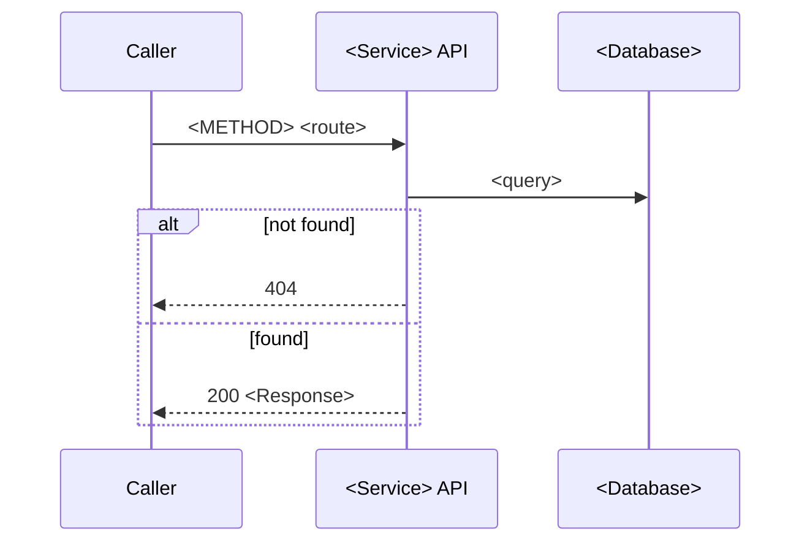

# <Group name> endpoints

<One sentence: what this group of endpoints is about, in business words.>

Source: `<path/to/Controller.cs>` · Base route: `<api/v1/orders>` · Auth: <default for the group>

| Method | Route | Who can call it | Purpose |
|--------|-------|-----------------|---------|
| `GET` | `/api/v1/orders/{id}/landed-cost` | users with role `Finance` | Returns the landed cost of an order |

---

## `<METHOD> <route>`

### In short

<1–2 sentences, business language.>

### Request

| Part | Name | Type | Required | Rules / meaning |
|------|------|------|----------|-----------------|
| route | `id` | string | yes | purchase order number |
| query | `currency` | string | no | ISO code, default `EUR` |
| body | `<Field>` | <type> | <yes/no> | <validation rule from code> |

```http
<METHOD> <local base URL from launchSettings.json>/<route>
Content-Type: application/json

{ <example body with made-up data> }
```

### Who can call it

<Plain words> — technical: `<[Authorize(Policy = "...")]` / scope / role>.

### What it does

1. <Step in words> — `<Class.Method>` `<file:line>`
2. <If X doesn't exist → returns 404.>
3. <Saves … / publishes `<MessageType>` to topic `<name>`.>



<One sentence explaining the diagram.>

### Response

| Status | Meaning for the caller |
|--------|------------------------|
| 200 | <…> |
| 400 | <validation failed — which rules> |
| 404 | <…> |

```json
{ <example response with made-up data> }
```

### Side effects

<Data written, messages published, external calls, emails — or "none (read-only)".>

### Testing notes

- `curl -X <METHOD> "<local URL>/<route>" -H "Authorization: Bearer <token>"`
- Edge cases: <…>
- Expected errors: <…>

### Open questions

- <…> (also in [handover questions](../handover/questions.md))
