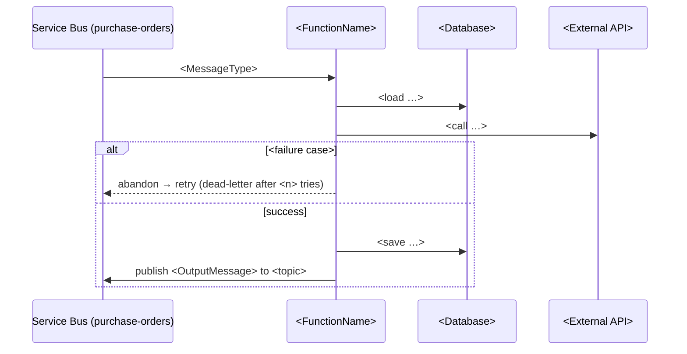

# <FunctionName>

*<Azure Function | Background service | Message consumer | Hangfire job | Kubernetes CronJob> — <trigger type>*

## In short

<2–3 sentences in business language: when it runs, what it does, why it matters.
Example: "When a purchase order is received, this function calculates the landed cost (price + shipping + customs
+ fees) and stores it, so Finance sees the real cost of the goods.">

## Trigger

| | |
|---|---|
| **Type** | <Service Bus topic / Timer / HTTP / Blob / Event Grid / …> |
| **Source** | <topic `purchase-orders`, subscription `landed-cost`> / <`0 0 2 * * *` — every day at 02:00 UTC> / <`POST /api/...`, AuthorizationLevel Function> |
| **Details** | <sessions, batch size, RunOnStartup, time zone, consumer group …> |
| **Runs in** | <Function App `<name>` (isolated, Premium plan) / AKS namespace `<ns>`> |

## Input

`<MessageType>` — <what it represents>

| Field | Type | Meaning |
|-------|------|---------|
| `OrderId` | string | <…> |

```json
{ <example message with made-up data> }
```

## What it does

1. <Step in words> — `<Class.Method>` `<file:line>`
2. <…>
3. <…>



<One sentence explaining the diagram.>

## Output

<Data written, messages published (type + topic/queue), HTTP response, files created.>

## When it fails

| Situation | What happens |
|-----------|--------------|
| <Exception / dependency down> | <retried n times (policy), then dead-letter / poison queue / logged and dropped> |
| Same message arrives twice | <idempotent because … / not idempotent — would …> **(inferred)** |
| Timeout | <functionTimeout …> |

## Scaling and concurrency

<maxConcurrentCalls, batchSize, singleton, KEDA rule, replicas — or "default settings">

## Configuration

| Key | Purpose | Source |
|-----|---------|--------|
| `<Section:Key>` | <…> | <appsettings / app setting / Key Vault / Helm value> |

## Testing notes

- How to trigger: <send a test message to `<topic>` in dev / `POST http://localhost:7071/admin/functions/<FunctionName>` with `{}` for a timer function locally / upload a blob to `<container>`>
- Edge cases: <…>
- Expected result: <…>

## Source

`<file:line>` · tests: `<test file>` or "no tests"

## Open questions

- <…> (also in [handover questions](../handover/questions.md))
