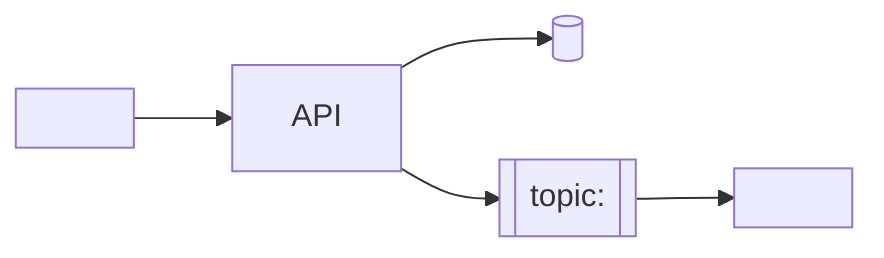

# <Service name>

## In short

<2–3 sentences in business language: what this service is for, who benefits, what would stop working without it.>

| | |
|---|---|
| **Repository** | `<repo>` |
| **Runs on** | <AKS (namespace `<ns>`) / Azure Function App `<name>` / App Service `<name>`> |
| **Main parts** | <API, Function App, worker, CronJob …> |
| **Used by** | <callers found in code/config, or "unknown — see questions"> |
| **Depends on** | <databases, Service Bus, external APIs, other services> |
| **.NET** | <net8.0 …> |
| **Previous owner** | <team, or "unknown"> |

## What it does

- <capability 1 in plain words> → [endpoints](endpoints/README.md) / [functions](functions/README.md)
- <capability 2>

## Big picture

<One sentence explaining the diagram.> More in [architecture](architecture.md).

## Where to start

| You are… | Read |
|----------|------|
| Product owner / manager | this page, [functions](functions/README.md) "In short" sections, [handover questions](handover/questions.md) |
| Tester | [endpoints](endpoints/README.md), [functions](functions/README.md) testing notes, [operations](operations.md) |
| Developer | [architecture](architecture.md), [endpoints](endpoints/README.md), [operations](operations.md), [configuration](configuration.md) |
| Architect | [architecture](architecture.md), [integrations](integrations.md), [deployment](deployment.md), [health report](handover/health-report.md) |

## All pages

- [Architecture](architecture.md) · [Endpoints](endpoints/README.md) · [Azure Functions](functions/README.md) ·
  [Background jobs](background-jobs/README.md) · [Messaging](messaging.md) · [Integrations](integrations.md) ·
  [Data model](data-model.md) · [Configuration](configuration.md) · [Security](security.md) ·
  [Pipelines](pipelines.md) · [Deployment](deployment.md) · [Operations](operations.md) · [Glossary](glossary.md)
- Handover: [Questions for the previous team](handover/questions.md) · [Health report](handover/health-report.md)
